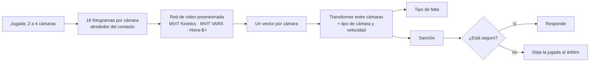

# Asistente VAR que sabe cuándo dudar

Clasificación del **tipo de falta** y de la **sanción** en jugadas de fútbol vistas desde varias cámaras, con redes de video preentrenadas, sobre el dataset **SoccerNet-MVFoul**.

**Autor:** Matías Martínez Moreno

## La idea

En una revisión VAR el árbitro mira la misma jugada desde varias cámaras y decide dos cosas: qué falta fue y qué sanción merece. Este proyecto entrena un modelo que hace lo mismo y que, además, dice qué tan seguro está, para que las jugadas dudosas queden en manos del árbitro.

- **Entrada:** de 2 a 4 clips de la misma jugada (toma en vivo y repeticiones), 16 fotogramas cada uno alrededor del contacto.
- **Salida:** tipo de falta (8 clases), sanción (sin falta, sin tarjeta, amarilla o roja) y la confianza del modelo.

El trabajo responde tres preguntas:

1. **¿Se sostiene la cifra publicada?** Se evalúa VARS, el modelo de los creadores del dataset, con sus pesos públicos y la métrica oficial.
2. **¿Aporta algo la transferencia?** Se comparan tres redes preentrenadas y tres niveles de ajuste fino, y una ablación muestra qué partes de la cabeza sirven.
3. **¿Cuándo se puede confiar en el modelo?** Calibración, abstención, jugadas dudosas y peso de cada cámara.

## Cómo funciona

El entrenamiento va en tres pasos:
1. Se entrena solo la cabeza, con la red congelada.
2. Se afina la red.
3. Se reentrena la cabeza sobre las características de la red afinada (la «segunda etapa» que usó el ganador del reto SoccerNet 2025).

## Resultados

Todo corrió en una sola sesión gratuita de Kaggle: **6,4 h en 2 GPU T4**. La métrica es la oficial del reto: el promedio de la exactitud balanceada (BA) del tipo de falta y de la sanción, en las 251 jugadas evaluables del test.

| Modelo | BA combinada (IC 95 %) | BA tipo de falta | BA sanción |
|---|---|---|---|
| VARS, cifra del paper | 37,5 | 41,0 | 34,0 |
| VARS con sus pesos, evaluado aquí | **39,9** (33,2 – 47,4) | 43,9 | 35,9 |
| Hiera-B+ afinado + segunda etapa (este trabajo) | **39,8** (34,4 – 45,7) | 41,2 | **38,3** |

- **Verificación:** VARS da 39,9 con sus propios pesos, algo más que lo publicado. Esa es la referencia justa.
- **Empate con VARS.** La diferencia está entre −8,6 y +8,1 puntos: con solo 5 rojas en el test, no se puede separar a dos modelos tan cercanos.
- **Mejor en la sanción** (exactitud 51,4 % contra 36,3 %) y peor en el tipo de falta (47,0 % contra 55,0 %).
- **Lo que más aportó:**
  - afinar la red: +2 a +4,5 puntos;
  - partir de una red que ya vio faltas: VARS congelado 36,1 contra Kinetics congelado 31,0;
  - la segunda etapa en Hiera: de 35,3 a 39,8.
- **Saber cuándo dudar:** si responde solo en el 68 % de las jugadas donde está más seguro, la exactitud de la sanción sube de 51,4 % a 59,1 %.
- **Lo que no funcionó:**
  - la sanción ordinal;
  - los atributos del árbitro como tareas extra;
  - reconocer las jugadas donde el árbitro dudó (AUROC 0,44, como el azar);
  - las rojas: no acierta ninguna (0 de 5).

El detalle de cada experimento, las gráficas y las limitaciones están en el notebook.

## Archivos

- [`asistente_var.ipynb`](asistente_var.ipynb): el notebook completo, ya ejecutado, con sus salidas y una explicación después de cada resultado. Las figuras que mostraban fotogramas de los videos se retiraron por el NDA.

## Cómo reproducirlo

1. Pedir acceso a SoccerNet-MVFoul firmando el NDA en [soccer-net.org](https://www.soccer-net.org/data).
2. Subir el notebook a Kaggle. En *Settings*: **GPU T4 x2** e **Internet On**.
3. En *Add-ons → Secrets*, crear `SOCCERNET_PASSWORD` con la contraseña del NDA.
4. *Save Version → Save & Run All.* Los resultados quedan en `outputs/`.

La contraseña nunca se escribe en el código y los videos se borran al terminar la sesión.

## Datos y créditos

**SoccerNet-MVFoul** tiene 3 901 jugadas de ligas profesionales europeas, cada una vista desde 2 a 4 cámaras y anotada por un árbitro profesional. Lo crearon Jan Held, Anthony Cioppa, Silvio Giancola, Abdullah Hamdi, Bernard Ghanem y Marc Van Droogenbroeck (Universidad de Lieja y KAUST), como parte de [SoccerNet](https://www.soccer-net.org/).

Los videos están protegidos por un acuerdo de confidencialidad: **este repositorio no incluye videos, fotogramas ni pesos entrenados con ellos.**

El código y los pesos de VARS vienen del repositorio oficial [SoccerNet/sn-mvfoul](https://github.com/SoccerNet/sn-mvfoul).

## Referencias

**Dataset y punto de partida**
- Held, J., Cioppa, A., Giancola, S., Hamdi, A., Ghanem, B. y Van Droogenbroeck, M. (2023). [VARS: Video Assistant Referee System for Automated Soccer Decision Making from Multiple Views](https://arxiv.org/abs/2304.04617). CVPR Workshops.
- Held, J., Cioppa, A., Giancola, S., Hamdi, A., Devue, C., Ghanem, B. y Van Droogenbroeck, M. (2024). [Towards AI-Powered Video Assistant Referee System (VARS) for Association Football](https://arxiv.org/abs/2407.12483). arXiv.
- Giancola, S., Cioppa, A. et al. (2025). [SoccerNet 2025 Challenges Results](https://arxiv.org/abs/2508.19182). arXiv.

**Redes preentrenadas**
- Kay, W. et al. (2017). [The Kinetics Human Action Video Dataset](https://arxiv.org/abs/1705.06950). arXiv.
- Li, Y., Wu, C.-Y., Fan, H., Mangalam, K., Xiong, B., Malik, J. y Feichtenhofer, C. (2022). [MViTv2: Improved Multiscale Vision Transformers for Classification and Detection](https://arxiv.org/abs/2112.01526). CVPR.
- Ryali, C., Hu, Y.-T., Bolya, D., Wei, C., Fan, H., Huang, P.-Y. et al. (2023). [Hiera: A Hierarchical Vision Transformer without the Bells-and-Whistles](https://arxiv.org/abs/2306.00989). ICML.
- He, K., Chen, X., Xie, S., Li, Y., Dollár, P. y Girshick, R. (2022). [Masked Autoencoders Are Scalable Vision Learners](https://arxiv.org/abs/2111.06377). CVPR.

**Técnicas**
- Kumar, A. et al. (2022). [Fine-Tuning can Distort Pretrained Features and Underperform Out-of-Distribution](https://arxiv.org/abs/2202.10054). ICLR.
- Menon, A. K. et al. (2021). [Long-tail Learning via Logit Adjustment](https://arxiv.org/abs/2007.07314). ICLR.
- Guo, C., Pleiss, G., Sun, Y. y Weinberger, K. Q. (2017). [On Calibration of Modern Neural Networks](https://arxiv.org/abs/1706.04599). ICML.
- Geifman, Y. y El-Yaniv, R. (2017). [Selective Classification for Deep Neural Networks](https://arxiv.org/abs/1705.08500). NeurIPS.
- Peterson, J. C. et al. (2019). [Human Uncertainty Makes Classification More Robust](https://arxiv.org/abs/1908.07086). ICCV.
- Selvaraju, R. R. et al. (2017). [Grad-CAM: Visual Explanations from Deep Networks via Gradient-based Localization](https://arxiv.org/abs/1610.02391). ICCV.

El resto de las referencias (CORN, R(2+1)D, ResNet, VideoMAE) está al final del notebook.
